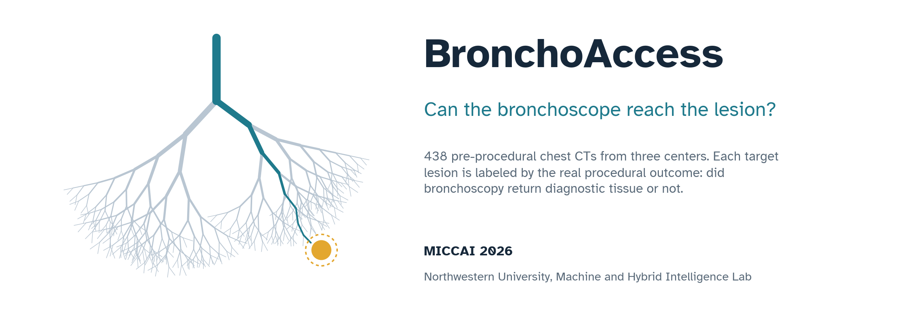
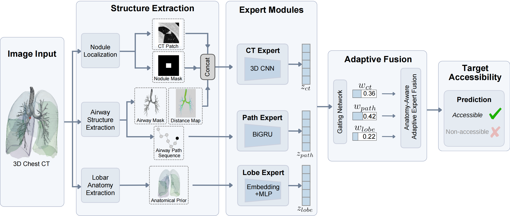

<p align="center">
  
</p>

<p align="center">
  <a href="https://arxiv.org/abs/2609.37386"></a>
  <a href="https://nubagcilab.github.io/BronchoAccess/"></a>
  <a href="https://nubagcilab.github.io/BronchoAccess/"></a>
  <a href="https://huggingface.co/datasets/linkai-peng/BronchoAccess"></a>
  <a href="https://creativecommons.org/licenses/by-nc/4.0/"></a>
</p>

# BronchoAccess

Official PyTorch implementation of **Anatomy-Aware Prediction of Bronchoscopic Accessibility from 3D CT** (MICCAI 2026).

Before a navigation bronchoscopy, clinicians judge from CT whether the scope can reach a lung lesion. In our reader study, 22 clinicians reached an AUROC of 0.5661 on this task. We predict the procedural outcome directly from pre-procedural CT with an anatomy-aware mixture-of-experts, reaching **0.8052 AUROC** with 3.83M parameters.

## Highlights

- **A new task with real outcomes.** Labels come from biopsy results confirmed by histopathology, not from expert opinion.
- **Anatomy-aware design.** Three experts read the lesion patch, the airway route, and the lesion lobe. A gating network weighs them per case.
- **Public data.** All 438 cases are released on [Hugging Face](https://huggingface.co/datasets/linkai-peng/BronchoAccess).

## Method

<p align="center">
  
</p>

| Expert | Input | Encoder |
| --- | --- | --- |
| CT expert | 128 x 128 x 32 patch: CT (lung window), lesion mask, airway distance map | 3D residual CNN with squeeze-and-excitation |
| Path geometry expert | Airway route from trachea to target, ordered proximal to distal | Bidirectional GRU |
| Lobe expert | Lobe that holds the target (`RUL`, `RML`, `RLL`, `LUL`, `LLL`) | Learned embedding |

A gating network, conditioned on lesion position, lobe, and airway statistics, fuses the three experts. The gate weights show which anatomical factor drives each prediction.

## Results

AUROC and PR-AUC under 5-fold patient-level cross-validation on 438 cases. The full table is on the [dataset page](https://huggingface.co/datasets/linkai-peng/BronchoAccess#benchmark).

| Method | Input | AUROC | PR-AUC |
| --- | --- | ---: | ---: |
| 22 clinician readers | CT and target location | 0.5661 | 0.7434 |
| Logistic regression | Handcrafted geometry | 0.5128 | 0.6897 |
| ResNet-18 | CT volume | 0.6333 | 0.7700 |
| GCN | Airway graph | 0.6483 | 0.7666 |
| EfficientNet-b0 | Our 3-channel patch | 0.7310 | 0.8269 |
| **Anatomy-aware MoE (ours)** | **Patch + route + lobe** | **0.8052** | **0.8496** |

## Getting started

### 1. Install

```bash
git clone https://github.com/NUBagciLab/BronchoAccess.git
cd BronchoAccess
conda env create -f environment.yml
conda activate bronchoaccess
```

The environment uses Python 3.10, PyTorch 1.13 with CUDA 11.7, and PyTorch Geometric. For other CUDA versions, see the [PyTorch Geometric install guide](https://pytorch-geometric.readthedocs.io/en/latest/install/installation.html).

### 2. Download the data

The model only needs the preprocessed files (about 3 GB). Skip `images/` unless you want the raw CT.

```python
from huggingface_hub import snapshot_download

snapshot_download(
    repo_id="linkai-peng/BronchoAccess",
    repo_type="dataset",
    local_dir="data/BronchoAccess",
    allow_patterns=["labels.csv", "patches/*", "graphs/*"],
)
```

```
data/BronchoAccess/
├── patches/      # <case_id>.pt, 3 x 128 x 128 x 32 lesion patch
├── graphs/       # <case_id>.pt, airway graph (PyTorch Geometric Data)
└── labels.csv    # case_id, label, target_nodule_location
```

### 3. Train

```bash
python src/train.py 
```

### 4. Test

```bash
python src/test.py 
```

## Repository structure

```
BronchoAccess/
├── src/
│   ├── dataset.py     # loads patches, airway graphs, lobe, and labels
│   ├── model.py       # CT, path geometry, and lobe experts with the gating network
│   ├── train.py       # training with 5-fold patient-level cross-validation
│   └── test.py        # evaluation: AUROC, PR-AUC, accuracy, F1
├── environment.yml
├── README.md
└── index.html, static/  # project page, served by GitHub Pages
```

Run all commands from the repository root.

## Citation

```bibtex
@inproceedings{peng2026bronchoaccess,
  title     = {Anatomy-Aware Prediction of Bronchoscopic Accessibility from 3D CT},
  author    = {Peng, Linkai and Sun, Cuiling and Wang, Bin and Rowell, Jamie and Gao, Catherine and Ikizgul, Oyku and Sentasci, Eminenur and Bejar, Andrea and Aktas, Halil Ertugrul and Durak, Gorkem and Wahidi, Momen and Kapp, Christopher and Bagci, Ulas},
  booktitle = {Medical Image Computing and Computer Assisted Intervention (MICCAI)},
  pages     = {32--42},
  year      = {2026},
  publisher = {Springer}
}
```

## License

Code and data are released under [CC BY-NC 4.0](https://creativecommons.org/licenses/by-nc/4.0/) for non-commercial research use only. Not for clinical decision making.

## Acknowledgments

This work was partially supported by NIH R01-HL171376. The project page is built on the [Academic Project Page Template](https://github.com/eliahuhorwitz/Academic-project-page-template).

## Contact

Corresponding author: Ulas Bagci ([ulas.bagci@northwestern.edu](mailto:ulas.bagci@northwestern.edu)). For questions about the code, please open an issue.